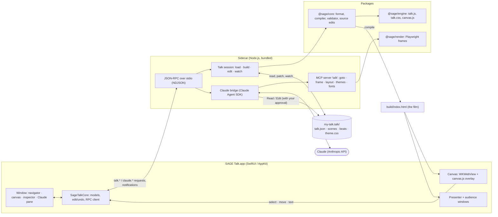

# SAGE Talk

A native macOS editor and presenter for animation-first research talks, with Claude built in.

A SAGE talk is a continuous film with checkpoints: one deterministic animation at a fixed
1920×1080 stage that pauses at *holds*, one idea per click. Claude writes the motion as code
(the `academic-talk-film` skill); you make the quick edits yourself, Keynote-style, directly on
the canvas, and present with a presenter display. The same talk compiles to a single HTML file
you can put on a website.

[](https://github.com/SageSELab/sage-slide-editor/actions/workflows/ci.yml)

## Features

- **Edit on the canvas.** Whenever the film is paused, click to select, drag to move, resize
  with handles, and type into text in place. Smart guides, a position readout, and Keynote's
  modifier keys (Shift constrains, Option resizes from the centre, ⌘ turns off snapping). Click
  through groups to reach the text inside a card.
- **Claude in a side pane.** Claude Code runs locally on the talk folder, with the paper and
  code you attach as materials. Watch it build slides in real time, choose the model (Fable,
  Opus, Sonnet, Haiku) and effort, and approve anything that touches files outside the talk.
- **Navigator, inspector and timeline.** Chapters and holds with thumbnails, per-beat timing
  and speaker notes, and a scrubber with chapter segments.
- **Themes and fonts.** Light and dark palettes, type scale and fonts as shareable
  `.talktheme` files; Google Fonts (open licences only) embedded in the talk.
- **Present and rehearse.** Audience film and presenter notes on the displays you choose,
  with clocks, the next hold and live display swapping.
- **Publish.** One self-contained HTML file with private chapters, backups and notes removed.
- **Undo everything.** Every edit is a precise source patch with an inverse; edits by Claude or
  another editor are never clobbered.

## Install

Requirements: a Mac with Apple silicon, macOS 15 or later. Claude features need a Claude login
(the Claude Code login on the Mac, or an Anthropic API key); the setup assistant checks this on
first launch.

1. Download `SAGE-Talk-<version>.zip` from the
   [latest release](https://github.com/SageSELab/sage-slide-editor/releases/latest).
2. Unzip it and move **SAGE Talk.app** to **Applications**.
3. The app is not notarized yet, so the first time, Control-click it and choose **Open**
   (or run `xattr -dr com.apple.quarantine "/Applications/SAGE Talk.app"`).

The app is self-contained: it bundles its own Node.js runtime, the sidecar and the skill, and
does not need this repository.

### First talk

- **File ▸ New Talk…** (⌘N) creates a `.talk` package from the starter.
- To look around a full talk, copy `fixtures/issta26` from this repository somewhere else and
  open the copy (**File ▸ Open Talk…**).
- Press Space to play to the next hold; pause anywhere to edit.

## How it works



- **The talk format (`sage-talk/1`).** A talk is a folder (usually a `.talk` package):
  `talk.json` is the spine (chapters, beats, holds, notes), `scenes/*.html` hold the objects,
  `beats/*.js` the motion relative to each beat, plus `lib/`, `theme.css` and `assets/`.
- **The film.** `@sage/core` compiles a talk into one HTML file run by the `talk.js` engine:
  deterministic `render(t)`, holds as checkpoints. The canvas, the presenter, thumbnails,
  `talkc shoot` and the published page all play this same file.
- **Editing.** The app injects `canvas.js` into the canvas film. Every gesture becomes one
  `talk.edit` request (`setText`, `setStyle`, `insertBeat`, …); the sidecar patches only the
  affected bytes of the source, writes atomically, and returns an inverse for undo. A file
  watcher labels each change as the app's, Claude's or external, and the film rebuilds.
- **Claude.** The sidecar runs the Claude Agent SDK with the talk as its working directory,
  your materials as extra directories, the bundled skill, and an MCP server of app tools
  (render a frame, jump the canvas, read the layout, apply a theme). Edits stream into the
  canvas as Claude makes them.

## Repository layout

```
apps/mac/               SwiftUI/AppKit app (SwiftPM)
  Sources/SageTalk/       windows, canvas host, inspector, Claude pane, presenter, self-test
  Sources/SageTalkCore/   AppKit-free models and the sidecar client (unit-tested)
  Tests/                  Swift Testing suites
  packaging/              icons (SVG), Info.plist fragments, document types
  scripts/                bundle.sh, selftest.sh, package.sh, package-smoke.sh, notarize.sh
packages/
  engine/                 talk.js engine, talk.css, canvas.js editing overlay
  core/                   sage-talk/1 schema, loader, compiler, validator, source edits, talkc CLI
  render/                 Playwright frame rendering (talkc shoot, Claude's talk_frame)
  sidecar/                the Node process: JSON-RPC server, watcher, themes, Claude bridge
skill/academic-talk-film/ the Claude skill that authors talks (bundled into the app)
fixtures/
  issta26/                a full real talk in sage-talk/1 (used by tests and the self-test)
  issta26-original/       the hand-written single-file deck it was ported from (read-only)
tests/
  rpc/                    JSON-RPC fixtures shared by the TypeScript and Swift tests
  claude/                 recorded Claude sessions replayed by the bridge tests
  golden/                 golden-frame harness (WebKit / Chromium)
  themes/                 theme fixtures
docs/                     rpc.md (protocol), packaging.md, phase0-memo.md
spikes/                   Phase 0 experiments (format port, WebKit, SDK)
PLAN.md                   design, phases and the testing strategy
```

## Development

### Prerequisites

- macOS 15+ on Apple silicon
- Xcode 16 or later (Swift 6 toolchain): `xcode-select --install` is enough for SwiftPM
- Node.js 24 (`brew install node@24`, or nvm/fnm)
- pnpm via Corepack: `corepack enable`
- Google Chrome (only for the Chromium golden comparison)

### Set up

```sh
git clone https://github.com/SageSELab/sage-slide-editor.git
cd sage-slide-editor
corepack enable
pnpm install
# browsers for the render and canvas tests
pnpm --filter @sage/render exec playwright install chromium webkit
```

### Run the app from source

```sh
bash apps/mac/scripts/bundle.sh            # builds apps/mac/build/SageTalk.app (debug)
open apps/mac/build/SageTalk.app
```

The development app runs the sidecar straight from this checkout
(`node --import tsx packages/sidecar/src/main.ts`), so TypeScript changes take effect on the
next talk you open; Swift changes need `bundle.sh` again. `SAGE_REPO` and `SAGE_NODE` override
the baked-in repo and Node paths.

### The compiler on the command line

```sh
node packages/core/src/cli.ts validate fixtures/issta26 --render
node packages/core/src/cli.ts build fixtures/issta26 --out /tmp/issta-build
node packages/core/src/cli.ts layout fixtures/issta26
node packages/core/src/cli.ts shoot fixtures/issta26 --holds --out /tmp/issta-frames
node packages/core/src/cli.ts publish fixtures/issta26 my-talk --out /tmp/issta-public
```

### Tests

| What | Command |
|---|---|
| All TypeScript tests | `pnpm test` (or `npx vitest run` inside one package) |
| Typecheck | `pnpm typecheck` |
| Swift unit and integration tests | `cd apps/mac && swift test` |
| App self-test (drives the real app, renders its own windows to PNGs) | `bash apps/mac/scripts/selftest.sh "$(mktemp -d)/ISSTA.talk"` after copying `fixtures/issta26` there |
| Golden frames: the port against the original deck, every hold (Chromium) | `(cd spikes/format && npm ci)`, `node packages/core/src/cli.ts build fixtures/issta26`, then `node spikes/format/diff.mjs` |
| Packaged app smoke test | `bash apps/mac/scripts/package.sh && bash apps/mac/scripts/package-smoke.sh` |

Tests that would change files use temporary copies: never edit `fixtures/issta26-original`.
Tests never call Claude live; the bridge is tested by replaying recorded sessions in
`tests/claude/`. The self-test only draws the app's own windows (no screen capture).

### Packaging

`apps/mac/scripts/package.sh` builds `apps/mac/build/SAGE Talk.app`: a release build with a
pinned, checksum-verified Node.js runtime, the bundled sidecar (esbuild), the skill, Playwright
and the icons, ad-hoc signed with the hardened runtime. See [docs/packaging.md](docs/packaging.md).
Developer ID signing and notarization (`notarize.sh`) need an Apple Developer account.

## CI/CD

GitHub Actions ([`.github/workflows`](.github/workflows)):

- **CI** (`ci.yml`), on every push to `main` and every pull request: TypeScript typecheck and
  tests (core, sidecar, engine, render), Swift build and tests, the app self-test on a copy of
  `fixtures/issta26`, the golden-frame comparison against the original deck (Playwright Chromium, every hold ± 0.5 s), and a packaged
  build with its smoke test. The packaged app is uploaded as a build artifact.
- **Release** (`release.yml`), on a `v*` tag: builds and smoke-tests the app and publishes
  `SAGE-Talk-<version>.zip` on a GitHub release.

```sh
git tag v0.2.0 && git push origin v0.2.0
```

## Documentation

- [PLAN.md](PLAN.md): design, decisions, phases and the testing plan
- [docs/rpc.md](docs/rpc.md): the app ↔ sidecar protocol
- [docs/packaging.md](docs/packaging.md): what is in the app bundle and how it is built
- [skill/academic-talk-film/SKILL.md](skill/academic-talk-film/SKILL.md): how Claude authors talks

## Contributing

Small, focused commits with a one-line summary of what changed. Run the TypeScript and Swift
tests before pushing; CI runs the rest. Protocol changes update `docs/rpc.md`, the fixtures in
`tests/rpc/`, and both the TypeScript and Swift checkers.

Built by the [SAGE Lab](https://sagelab.io).
